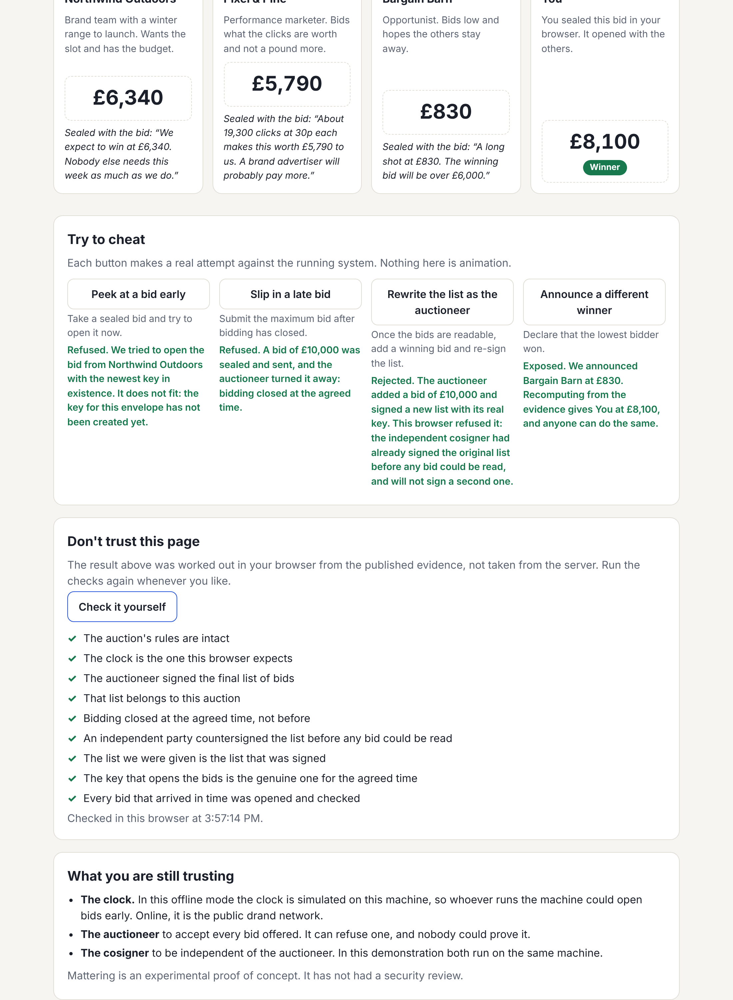

# The Sealed Room

A web page for showing Mattering to people who do not read code. Three software agents, each acting for a company, bid for an advertising package, the visitor can bid too, every bid opens at once when the clock runs out, and the visitor is invited to cheat.



**Status:** runs on a laptop, and is live at [mattering.ai/demo](https://mattering.ai/demo). It is a demonstration, and the service behind it is not hardened ([service.md](service.md)).

## Running it

Against the real drand network (needs internet):

```bash
npm run showcase
```

Against a simulated clock, for a room with no connection:

```bash
npm run showcase:offline
```

Then open http://127.0.0.1:8790. Set `PORT` to change the port. An auction takes about 45 seconds: 30 until bidding closes, then 15 until the bids open.

## What happens on the page

1. **Start the auction.** Three agents decide what to bid and seal their bids, one after another. Each also seals a sentence explaining its bid.
2. **Place your own bid.** It is sealed in the browser before it is sent, so the server never sees the amount.
3. **Bidding closes.** The auctioneer signs the list of bids and an independent cosigner countersigns it, while nobody can read it.
4. **The bids open.** The key is published and every envelope opens at the same moment. The browser works out the winner itself.

## The cheat buttons

Each makes a real attempt against the running system.

| Button | What it does | What stops it |
| --- | --- | --- |
| Peek at a bid early | Takes a sealed bid and tries to open it with the newest key that exists | The key for that envelope has not been created yet |
| Slip in a late bid | Seals the maximum bid and submits it after the close | The auctioneer refuses it; bidding closed at the agreed time |
| Rewrite the list as the auctioneer | After the bids are readable, the server adds a winning bid and signs a new list with the auctioneer's real key | The browser rejects it: the cosigner signed the original list first and will not sign another |
| Announce a different winner | Declares that the lowest bidder won | The browser recomputes the result from the evidence and shows the difference |

## What is real and what is staged

**Real:** the sealing, the time lock, the witness log, the receipts, the cosignature, the deadline, and the verification. The browser runs the same library as the tests, and takes evidence from the server but never a verdict. In online mode the browser accepts only the drand network's key, which is compiled into the page.

**Staged:**

- The companies and the lot are invented.
- Each agent is given a private ceiling, drawn at random for each auction, and decides what to bid. A language model decides if one is configured (next section); otherwise a short script does. The page says which, agent by agent.
- The auctioneer and the "independent" cosigner run in the same process on the same machine. The page says so.
- In offline mode the clock is simulated by the machine running the demo, which could therefore open bids early. The page shows a "Simulated clock" badge and says so.

## The agents and the language model

Each agent acts for one company: a description, and a ceiling on what it will pay that is drawn afresh for every auction. With a Claude API key configured, each agent's bid and its one-line rationale come from a language model, which is told the auction's rules, the lot and that agent's private ceiling. Without a key, a script bids a fraction of the ceiling.

```bash
ANTHROPIC_API_KEY=... npm run showcase
```

`MATTERING_MODEL` chooses the model; the default is `claude-haiku-5-5`, the smallest and cheapest current Claude model, which is enough for choosing a bid. Three requests are made per auction, one per agent, at low effort.

What the model can and cannot do:

- **It supplies two things:** a whole number of pounds and a short piece of text. Both are treated as untrusted input. An amount outside the auction's range, or anything that is not a number and a sentence, is thrown away and the script decides for that agent.
- **It has no part in any check.** Sealing, the deadline, the log, the cosignature and the verification never call a model. A model that bid foolishly would lose the auction; it could not break it.
- **If it is slow, fails or declines**, the script decides for that agent, and the page says "Bid chosen by a script".
- **Its decisions are held in memory only** until they are sealed, and are not stored.

The request to the model is covered by a test against a stand-in for the API (`tests/showcase.test.ts`). It was run by hand against the real API on 2026-11-24 with `claude-opus-5-5` and worked. Nothing checks the real API automatically, and the current default model has not been run against it yet.

## On the website

The same room runs on Cloudflare for mattering.ai, as a Durable Object behind the site's Worker (`apps/cloudflare`). The website is a separate repository and commits two files built from this one:

```bash
npm run build:site -- ../mattering-web
```

That writes the Worker to `src/worker.js` and the page's script to `public/assets/sealed-room.js` in the site repository. Rebuild and commit there whenever this repository changes.

How the hosted version differs from the laptop one:

- **One room per visitor.** Each browser session gets its own room: its own auctioneer key, cosigner key, log and auction. Visitors cannot see or affect each other's auctions.
- **Nothing happens until the visitor starts an auction**, so loading the page costs nothing.
- **Limits.** A room runs at most 20 auctions and takes at most 12 submissions per auction, refuses policies from outside, and deletes itself 30 minutes after it was last used.
- **The model has a daily allowance.** If the Worker has an `ANTHROPIC_API_KEY` secret, at most `MODEL_AUCTIONS_PER_DAY` auctions a day (default 300), across all visitors, use the model. After that, and if the counter cannot be reached, the scripts decide. This caps spending whatever the traffic. A spend limit on the API key itself is still worth setting.
- **The clock is always the real drand network.** A simulated clock is available for local development only (`npm run dev:offline` in the site repository).

The auctioneer and the cosigner still run in the same place, so the cosigner is not independent. The page says so.

## Not covered by automated tests

`tests/showcase.test.ts` runs an auction through the room and verifies it as the page does. The page itself was checked by driving it in a headless browser by hand; there is no browser test in the suite. On a laptop, online mode against live drand was run by hand on 2026-11-23 and behaved as described.

The Cloudflare version was run by hand in Cloudflare's local runtime with the simulated clock: a full auction in the real site page, with all four cheats refused. It was deployed to mattering.ai on 2026-11-23 and run there by hand against live drand, and worked. Nothing checks the deployed version automatically.
